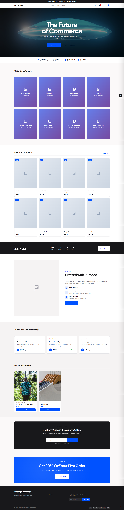

# FlowTheme



**FlowTheme** is a modern, highly customizable, and performance-optimized Shopify 2.0 theme designed for multi-niche e-commerce stores. Built with Shopify's Online Store 2.0 architecture, it supports JSON templates, app blocks, and dynamic data sources out of the box.

- **Version:** 1.0.0
- **Author:** Appixen
- **License:** MIT

---

## 🚀 Features

### 📦 Core Architecture
- **Shopify 2.0 Ready:** Full support for JSON templates and section blocks everywhere.
- **Mobile-First Design:** Responsive grid layouts optimized for all device sizes.
- **Performance Optimized:** Lazy loading, critical CSS inlining, and font preloading.
- **Niche Presets:** Built-in style configurations for Fashion, Tech, Luxury, Dropshipping, and Local businesses.

### 🛒 E-commerce Features
- **Advanced Cart:** Choose between Slide-out Drawer, Cart Page, or Modal Popup.
- **Free Shipping Bar:** Dynamic threshold-based shipping progress indicator.
- **Product Cards:** Quick Add to Cart, Wishlist toggles, Color Swatches, and Sale/New badges.
- **Collection Pages:** Filter sidebar, dynamic sorting, grid/column customization, and quick view.
- **Product Pages:** Sticky buy bar, image zoom, quantity selectors, and size guides.

### 🎨 Customization
- **Typography:** Choose from premium Google Fonts (Plus Jakarta Sans, Inter, DM Sans, Playfair Display, Space Grotesk).
- **Header Styles:** Default, Centered, or Minimal layouts with optional mega menu images.
- **Announcement Bar:** Configurable text, links, and visibility toggles.
- **GDPR Ready:** Built-in cookie consent banner and privacy settings.
- **Search:** Predictive search with result limits.

### 🧩 Built-in Sections
- Hero (with video/image backgrounds and overlay controls)
- Featured Collections & Products
- Countdown Banners & Promo Banners
- Image with Text & Trust Badges
- Testimonials & Newsletter Signup
- Rich Text & Spacer

---

## 📂 Installation

### Using Shopify CLI (Recommended)
1. Ensure you have [Shopify CLI](https://shopify.dev/docs/themes/tools-cli) installed.
2. Navigate to your theme directory:
   ```bash
   cd flowtheme
   ```
3. Connect to your store:
   ```bash
   shopify theme dev
   ```
4. Open the local development URL provided in the terminal.

### Manual Upload
1. Zip the entire `flowtheme` directory.
2. Go to **Online Store > Themes** in your Shopify Admin.
3. Click **Add theme** > **Upload zip file**.
4. Select the zipped file and upload.

---

## ⚙️ Customization

All theme settings are managed via the **Theme Editor** (`Customize` button in Shopify Admin).

### Global Settings
- **Logo & Branding:** Upload your logo, set width, and add a favicon.
- **Colors:** Customize primary, surface, text, and border colors.
- **Typography:** Select heading fonts and adjust base font sizes.
- **Cart Type:** Switch between Drawer, Page, or Modal cart experiences.
- **Niche Presets:** Apply pre-configured styling defaults for your specific industry.

### Page Customization
Each page (Home, Product, Collection, Blog, Cart) uses a modular JSON template system. Add, remove, or rearrange sections directly from the Theme Editor sidebar.

---

## 🛠 Development

### Prerequisites
- Node.js (v16+)
- Shopify CLI 3.x

### Commands
```bash
# Start local development server
shopify theme dev

# Push theme to Shopify (Live or Draft)
shopify theme push

# Pull theme from Shopify
shopify theme pull
```

### File Structure
```
├── assets/          # CSS, JS, and font files
├── config/          # Settings schema for theme editor
├── layout/          # Base theme.liquid layout
├── locales/         # Translation files
├── sections/        # Reusable section blocks
├── snippets/        # Small reusable components (product cards, icons, etc.)
└── templates/       # JSON templates for page routing
```

---

## 📸 Screenshot


---

## 🤝 Support & Documentation

- **Website:** [http://appixen.com/shopify](http://appixen.com/shopify)

---

## 📝 License

This project is licensed under the MIT License. See the `LICENSE` file for details.
